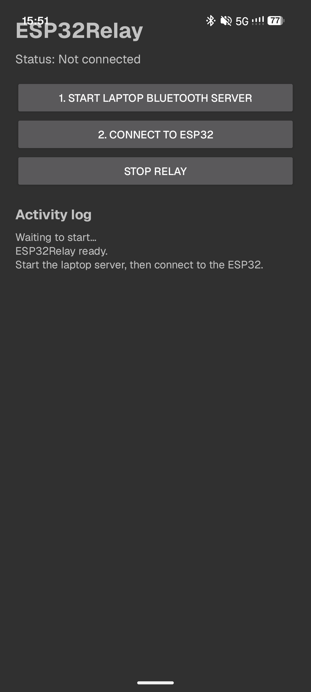
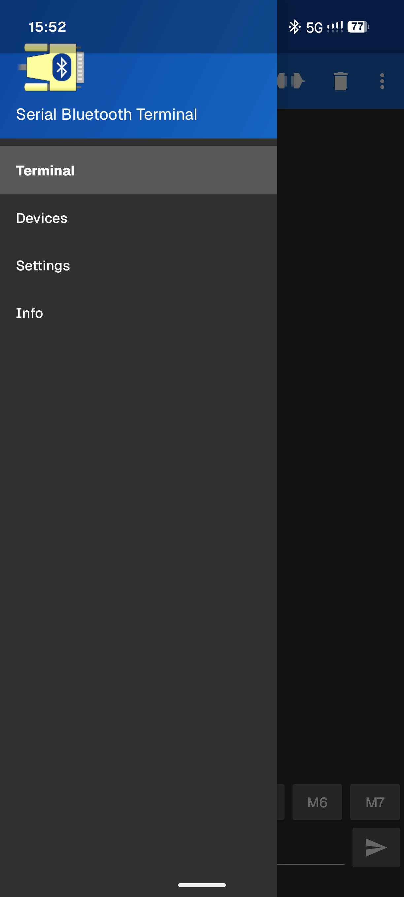
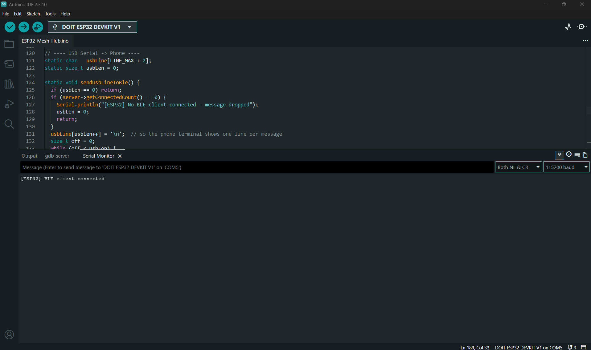

# ESP32Relay

A Bluetooth messaging project with an Android app, ESP32 firmware, and two Windows laptop scripts.

| Component | Location |
| --- | --- |
| Android app and Gradle project | `app/` and the repository root |
| ESP32 BLE-to-USB bridge | `firmware/ESP32_Mesh_Hub/ESP32_Mesh_Hub.ino` |
| Laptop connected to ESP32 over USB | `scripts/relay.py` |
| Friend's laptop terminal chat | `scripts/friend_chat.py` |

## Setup

1. Open the repository root in Android Studio, sync Gradle, and run the app on a Bluetooth-capable Android phone. Grant the requested Bluetooth permissions.
2. In Arduino IDE, select **ESP32 Dev Module** for an ESP32 DevKit V1, install **NimBLE-Arduino 2.x**, and flash the sketch. It advertises as `ESP32_Mesh_Hub` and uses the Nordic UART Service.
3. On both Windows laptops, install pySerial with `py -m pip install pyserial`. Pair the laptops and configure the incoming Bluetooth COM port on the relay laptop and the outgoing Bluetooth COM port on the friend's laptop.
4. On the relay laptop, run `py scripts/relay.py --list`. Edit the script's `BT_PORT` and `ESP_PORT` for the incoming Bluetooth port and ESP32 USB port. The USB default is 115200 baud. Close the Arduino Serial Monitor before starting `py scripts/relay.py`.
5. On the friend's laptop, run `py scripts/friend_chat.py --list`, set the outgoing Bluetooth COM port in the script, and run `py scripts/friend_chat.py`. Type a line and press Enter to send.

The laptop scripts also support a TCP fallback. Select TCP in both configuration blocks and set the friend's script to the relay laptop's address.

## Connect to the ESP32 from a friend's phone

Your phone runs ESP32Relay and forwards messages between your friend's phone over Bluetooth Classic and the ESP32 over Bluetooth Low Energy (BLE).

1. On your friend's Android phone, install **Serial Bluetooth Terminal** and pair their phone with yours in Bluetooth settings.
2. On your phone, open **ESP32Relay** and tap **1. Start Laptop Bluetooth Server**. This button also accepts connections from an Android phone.
3. On your friend's phone, open **Serial Bluetooth Terminal**, tap **Devices**, and select your phone from the paired Bluetooth Classic devices to connect.
4. On your phone, tap **2. Connect to ESP32**. Once ESP32Relay shows that the ESP32 is connected, your friend can send messages from the **Terminal** screen.

| Your phone | Your friend's phone |
| --- | --- |
|  |  |

### Verify the ESP32 connection

If the ESP32 is connected to your computer over USB, open the Arduino IDE Serial Monitor at **115200 baud**. When ESP32Relay connects to the board over BLE, the monitor displays `[ESP32] BLE client connected`.

